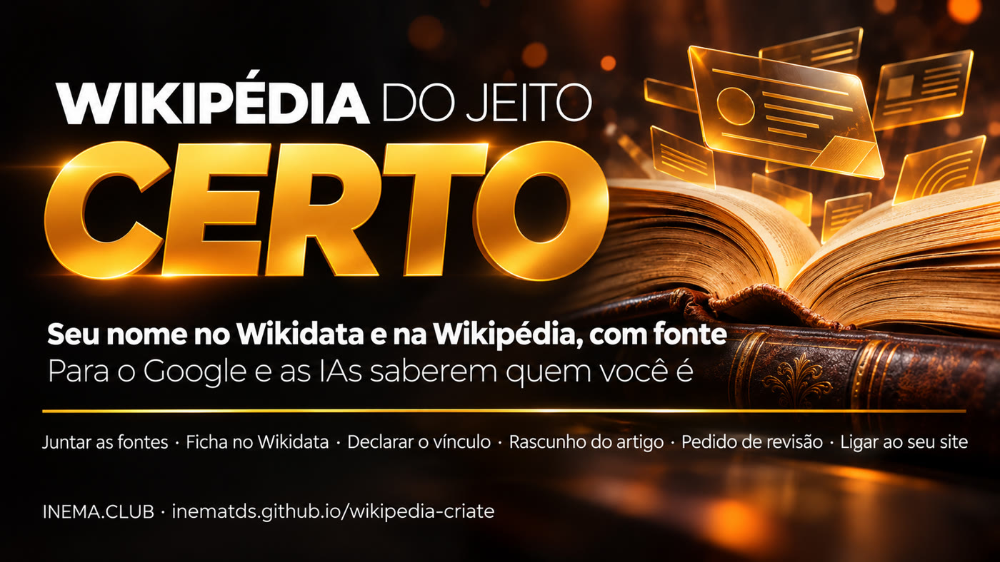

# 📚 Wikipedia the Right Way

[](https://inematds.github.io/wikipedia-criate/guia/en/)

**🇧🇷 [Português](README.md) · 🇺🇸 [English](README.en.md) · 🇪🇸 [Español](README.es.md)**

## What it is

This is a guide, with ready-made templates, for getting you or your company onto **Wikidata** (Wikipedia's open database, which search engines and AIs read) and, when there are enough sources, onto **Wikipedia**. It is meant for business owners, independent professionals, content creators, and anyone who looks after someone's public image. It teaches the path Wikipedia itself accepts: gather articles published by third parties, declare that the subject is you, and ask an independent editor to review. All you need are your old press articles and an AI assistant, such as Claude Code or Codex, to do the heavy lifting.

## 📖 Guide

**https://inematds.github.io/wikipedia-criate/guia/en/** (also in [Portuguese](https://inematds.github.io/wikipedia-criate/guia/) and [Spanish](https://inematds.github.io/wikipedia-criate/guia/es/))

## Why this matters for you and your business

- When someone asks Google or an AI who you are, the answer depends on what exists in open, reliable sources. Without an entry, the AI answers with little, with errors, or with someone who shares your name.
- Wikidata is open and public domain: search engines and AI trainers use this data. A neutral, sourced entry links your name, your company, your website, and your social networks.
- Customers, partners, and investors do research before closing a deal. Finding a sourced entry builds more trust than any ad.
- There is no guarantee of how each service uses this data. The sure gain is having your story documented in the place everyone consults.

## Start by pasting this into your AI (Claude Code or Codex)

```
Read the kit https://github.com/inematds/wikipedia-criate (README, the modelos/ folder and CASO-REAL.md). I want to put [YOUR NAME or YOUR COMPANY] on Wikidata and, if there are enough sources, on Wikipedia in Portuguese.
1. Look for articles about me in newspapers, magazines, universities, associations and web archives (arquivo.pt, web.archive.org). Open each page and copy the sentence that proves each fact. Build the dossier with template 01.
2. Tell me frankly: is Wikidata possible? Is Wikipedia possible? What is missing?
3. Build the Wikidata entry (template 02) using only what has a source.
4. Write the text of my user page (template 03) and a neutral article draft (template 04).
Do not create an account, do not publish anything and do not type any password. Show me everything first and wait for my yes.
```

## What's here

| File | What it's for |
|---|---|
| [modelos/01-dossie-de-fontes.md](modelos/01-dossie-de-fontes.md) (in Portuguese) | List of articles, with the sentence that proves each fact |
| [modelos/02-ficha-wikidata.md](modelos/02-ficha-wikidata.md) (in Portuguese) | Fields for the person's and the company's item, with property codes |
| [modelos/03-pagina-de-usuario.txt](modelos/03-pagina-de-usuario.txt) (in Portuguese) | Conflict-of-interest declaration (the account's first edit) |
| [modelos/04-rascunho-artigo.wiki](modelos/04-rascunho-artigo.wiki) (in Portuguese) | Skeleton of a neutral article, with citations |
| [modelos/05-pedido-de-revisao.txt](modelos/05-pedido-de-revisao.txt) (in Portuguese) | Review request for independent editors |
| [CASO-REAL.md](CASO-REAL.md) (in Portuguese) | The case of Nei Maldaner and SISNEMA (11/25/2026), with links, mistakes, and fixes |

## The process, start to finish

Who does it: 🧠 session with the person · 🤖 AI (Claude Code / Codex) · 👤 the person themself

1. 🤖 **Source dossier** (template 01). Search newspapers, universities, associations, arquivo.pt, and web.archive.org. Open each page and copy the literal sentence. A source pasted from another AI only counts after it has been checked.
2. 🧠 **Frank assessment.** Wikidata: needs a public source for each data point. Wikipedia: significant coverage in several independent sources. New brand with no press → Wikidata only (or nothing).
3. 🤖 **Wikidata entry** (template 02). Check whether the item already exists. Verify each property code on its page (e.g., https://www.wikidata.org/wiki/Property:P112).
4. 👤 **Wikimedia account** under a person's name (not a brand). Password and CAPTCHA are always handled by the person. The account works for both Wikidata and Wikipedia.
5. 🤖👤 **User page** (template 03) on Wikidata and Wikipedia: declare the connection before any other edit.
6. 🤖 **Wikidata items**, through the site's page (Special:NewItem), one statement at a time, with "reference URL" (P854) on each. Company first, person second, and link "founder" (P112).
7. 🤖 **Your website points to the item**: include the Wikidata link in the `sameAs` of the structured data (schema.org `Person` / `Organization`).
8. 🤖 **Article draft** (template 04) at `User:<Name>/Draft`: preview it, cut sentences without a source, keep categories turned off.
9. 🤖👤 **Review request** (template 05) at the help desk (Ajuda:Tire suas dúvidas). An independent editor is the one who moves it live.
10. 👤 **Follow up** through the notifications bell. Don't edit the article after it is published; request changes on the talk page.

## Technical setup

There is no program to install. It is a kit of texts and a static HTML guide.

**Prerequisites**
- An AI assistant with web access: Claude Code or Codex.
- A browser. A Wikimedia account created by the person (https://www.wikidata.org/wiki/Special:CreateAccount).

**How the AI did it in the real case (11/25/2026)**
- Research: public HTML pages (newspapers, arquivo.pt, Wayback). A page that loads through JavaScript was opened in the browser.
- Editing: a Chromium with its own profile, opened **on the person's screen** (`--remote-debugging-port`), driven by Playwright (`connectOverCDP`), clicking through the site's interface at a human pace and checking each save on the public page. The person logged in and solved each CAPTCHA in the same window.
- **No API and no QuickStatements.** Editing through the interface, with the person beside it, keeps humans in control. Mass or automated editing requires a bot account approved by the community: https://www.wikidata.org/wiki/Wikidata:Bots
- Global login: log in to Wikidata, then open `Especial:Entrar` on pt.wikipedia, and it logs you in without asking for the password again.

**Most-used Wikidata properties**

| Code | Name | Use |
|---|---|---|
| P31 | instance of | Q5 (human) or Q4830453 (business) |
| P21 / P27 | sex / nationality | person |
| P106 / P101 | occupation / field of work | person |
| P108 | employer | person → company |
| P112 | founder | company → person |
| P17 / P159 / P571 | country / headquarters / inception | company |
| P856 | official website | company |
| P2003 / P7085 / P2037 / P2397 | Instagram / TikTok / GitHub / YouTube | profiles |
| P854 | reference URL | inside each reference |

**Guide tests**
- All 3 languages respond (`/guia/`, `/guia/en/`, `/guia/es/`), the language selector navigates, no horizontal scrolling at 360 px.
- `python3 ~/projetos/wifi/scripts/pronto-para-revisar.py ~/projetos/wikipedia-criate` (internal INEMA check: links, languages, placeholders).

## Cautions (what not to do)

- Don't write like an ad ("renowned", "leader", "benchmark").
- Don't use a brand name for the account. Don't create multiple accounts. Don't ask friends to edit without declaring the connection.
- Don't publish straight to the main namespace. Don't fight over the text afterward.
- Don't use "advertorial" articles as proof of notability.
- Paid editing has its own rules and must be declared: https://foundation.wikimedia.org/wiki/Policy:Terms_of_Use

---

Independent project, not affiliated with the Wikimedia Foundation. Made by [INEMA.CLUB](https://inema.club).
