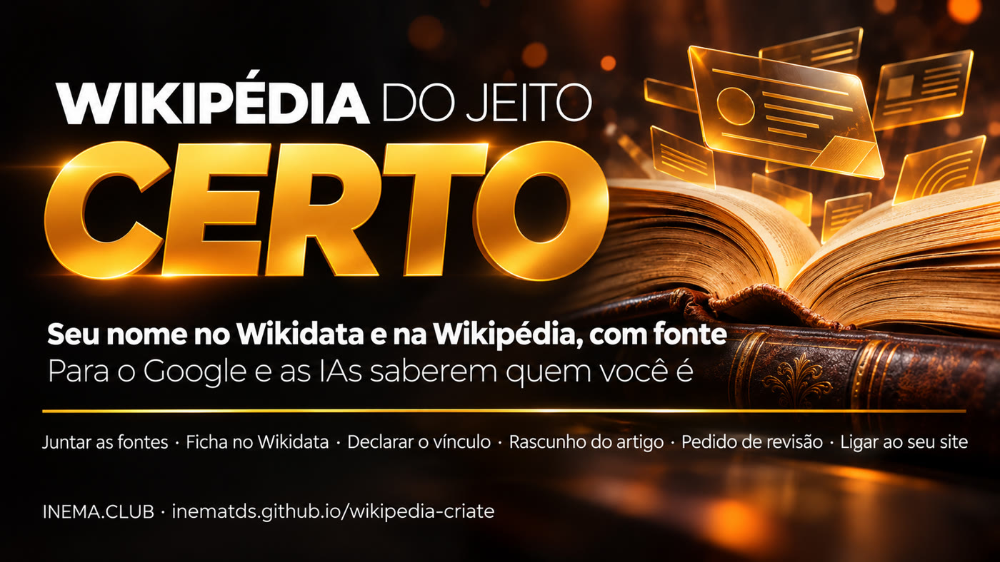

# 📚 Wikipédia do jeito certo

[](https://inematds.github.io/wikipedia-criate/guia/)

**🇧🇷 [Português](README.md) · 🇺🇸 [English](README.en.md) · 🇪🇸 [Español](README.es.md)**

## O que é

Este é um guia, com modelos prontos, para colocar você ou a sua empresa no **Wikidata** (a base de dados aberta da Wikipédia, que buscadores e IAs leem) e, quando houver fontes suficientes, na **Wikipédia**. Serve para empresário, profissional liberal, criador de conteúdo e quem cuida da imagem de alguém. Ensina o caminho que a própria Wikipédia aceita: juntar matérias publicadas por terceiros, declarar que o assunto é você e pedir que um editor independente revise. Você só precisa das suas matérias antigas e de um assistente de IA, como o Claude Code ou o Codex, para fazer a parte trabalhosa.

## 📖 Guia

**https://inematds.github.io/wikipedia-criate/guia/** (também em [inglês](https://inematds.github.io/wikipedia-criate/guia/en/) e [espanhol](https://inematds.github.io/wikipedia-criate/guia/es/))

## Por que isso importa para você e para o seu negócio

- Quando alguém pergunta ao Google ou a uma IA quem é você, a resposta depende do que existe em fontes abertas e confiáveis. Sem ficha, a IA responde com pouco, com erro ou com um homônimo.
- O Wikidata é aberto e de domínio público: buscadores e quem treina IAs usam esses dados. Uma ficha neutra, com fonte, liga seu nome, sua empresa, seu site e suas redes.
- Cliente, parceiro e investidor pesquisam antes de fechar. Achar uma ficha com fonte passa mais confiança do que qualquer anúncio.
- Não há garantia de como cada serviço usa esses dados. O ganho certo é ter a sua história documentada no lugar que todos consultam.

## Comece colando isto na sua IA (Claude Code ou Codex)

```
Leia o kit https://github.com/inematds/wikipedia-criate (README, pasta modelos/ e CASO-REAL.md). Quero colocar [SEU NOME ou SUA EMPRESA] no Wikidata e, se tiver fontes suficientes, na Wikipédia em português.
1. Procure matérias sobre mim em jornais, revistas, faculdades, associações e arquivos da web (arquivo.pt, web.archive.org). Abra cada página e copie a frase que comprova cada fato. Monte o dossiê com o modelo 01.
2. Diga com franqueza: dá para o Wikidata? Dá para a Wikipédia? O que falta?
3. Monte a ficha do Wikidata (modelo 02) só com o que tem fonte.
4. Escreva o texto da minha página de usuário (modelo 03) e um rascunho de artigo neutro (modelo 04).
Não crie conta, não publique nada e não digite senha. Mostre tudo antes e espere o meu sim.
```

## O que tem aqui

| Arquivo | Para quê |
|---|---|
| [modelos/01-dossie-de-fontes.md](modelos/01-dossie-de-fontes.md) | Lista das matérias, com a frase que comprova cada fato |
| [modelos/02-ficha-wikidata.md](modelos/02-ficha-wikidata.md) | Campos do item da pessoa e da empresa, com os códigos das propriedades |
| [modelos/03-pagina-de-usuario.txt](modelos/03-pagina-de-usuario.txt) | Declaração de conflito de interesse (primeira edição da conta) |
| [modelos/04-rascunho-artigo.wiki](modelos/04-rascunho-artigo.wiki) | Esqueleto de artigo neutro, com citações |
| [modelos/05-pedido-de-revisao.txt](modelos/05-pedido-de-revisao.txt) | Pedido de revisão para editores independentes |
| [CASO-REAL.md](CASO-REAL.md) | O caso do Nei Maldaner e da SISNEMA (25/11/2026), com links, erros e correções |

## O processo, do início ao fim

Quem faz: 🧠 sessão com a pessoa · 🤖 IA (Claude Code / Codex) · 👤 a própria pessoa

1. 🤖 **Dossiê de fontes** (modelo 01). Buscar em jornais, faculdades, associações, arquivo.pt e web.archive.org. Abrir cada página e copiar a frase literal. Fonte colada de outra IA só entra depois de conferida.
2. 🧠 **Avaliação franca.** Wikidata: precisa de fonte pública para cada dado. Wikipédia: cobertura significativa em várias fontes independentes. Marca nova sem imprensa → só Wikidata (ou nada).
3. 🤖 **Ficha do Wikidata** (modelo 02). Procurar se o item já existe. Conferir cada código de propriedade na página dele (ex.: https://www.wikidata.org/wiki/Property:P112).
4. 👤 **Conta Wikimedia** com nome de pessoa (não de marca). Senha e CAPTCHA sempre da pessoa. A conta vale para Wikidata e Wikipédia.
5. 🤖👤 **Página de usuário** (modelo 03) no Wikidata e na Wikipédia: declarar o vínculo antes de qualquer outra edição.
6. 🤖 **Itens no Wikidata**, pela página do site (Special:NewItem), uma declaração por vez, com "URL da referência" (P854) em cada uma. Empresa primeiro, pessoa depois, e ligar "fundador" (P112).
7. 🤖 **Seu site aponta para o item**: incluir o link do Wikidata no `sameAs` dos dados estruturados (schema.org `Person` / `Organization`).
8. 🤖 **Rascunho do artigo** (modelo 04) em `Usuário:<Nome>/Rascunho`: pré-visualizar, cortar frases sem fonte, categorias desligadas.
9. 🤖👤 **Pedido de revisão** (modelo 05) em Ajuda:Tire suas dúvidas. Quem move para o ar é um editor independente.
10. 👤 **Acompanhar** pelo sininho de notificações. Não editar o artigo depois de publicado; pedir mudanças na página de discussão.

## Instalação técnica

Não há programa para instalar. É um kit de textos e um guia em HTML estático.

**Pré-requisitos**
- Um assistente de IA com acesso à web: Claude Code ou Codex.
- Navegador. Conta Wikimedia criada pela pessoa (https://www.wikidata.org/wiki/Special:CreateAccount).

**Como a IA fez no caso real (25/11/2026)**
- Pesquisa: páginas HTML públicas (jornais, arquivo.pt, Wayback). Página que carrega por JavaScript foi aberta no navegador.
- Edição: um Chromium com perfil próprio aberto **na tela da pessoa** (`--remote-debugging-port`), conduzido pelo Playwright (`connectOverCDP`) clicando na interface do site, no ritmo de uma pessoa, e conferindo cada gravação na página pública. A pessoa fez login e resolveu cada CAPTCHA na mesma janela.
- **Sem API e sem QuickStatements.** A edição pela interface, com a pessoa ao lado, mantém o controle humano. Edição em massa ou automática exige conta de robô aprovada pela comunidade: https://www.wikidata.org/wiki/Wikidata:Bots
- Login global: entrar no Wikidata e depois abrir `Especial:Entrar` na pt.wikipedia loga sem pedir senha de novo.

**Propriedades do Wikidata mais usadas**

| Código | Nome | Uso |
|---|---|---|
| P31 | instância de | Q5 (ser humano) ou Q4830453 (negócio) |
| P21 / P27 | sexo / nacionalidade | pessoa |
| P106 / P101 | ocupação / campo de trabalho | pessoa |
| P108 | empregador | pessoa → empresa |
| P112 | fundador | empresa → pessoa |
| P17 / P159 / P571 | país / sede / fundação | empresa |
| P856 | página web oficial | empresa |
| P2003 / P7085 / P2037 / P2397 | Instagram / TikTok / GitHub / YouTube | perfis |
| P854 | URL da referência | dentro de cada referência |

**Testes do guia**
- Os 3 idiomas respondem (`/guia/`, `/guia/en/`, `/guia/es/`), seletor de idioma navega, sem rolagem horizontal em 360 px.

## Cuidados (o que não fazer)

- Não escrever como propaganda ("renomado", "líder", "referência").
- Não usar nome de marca na conta. Não criar várias contas. Não pedir a amigos sem declarar o vínculo.
- Não publicar direto no domínio principal. Não brigar pelo texto depois.
- Não usar matéria "publicitária" como prova de relevância.
- Edição paga tem regras próprias e precisa ser declarada: https://foundation.wikimedia.org/wiki/Policy:Terms_of_Use

---

Projeto independente, sem ligação com a Wikimedia Foundation. Feito por [INEMA.CLUB](https://inema.club).
